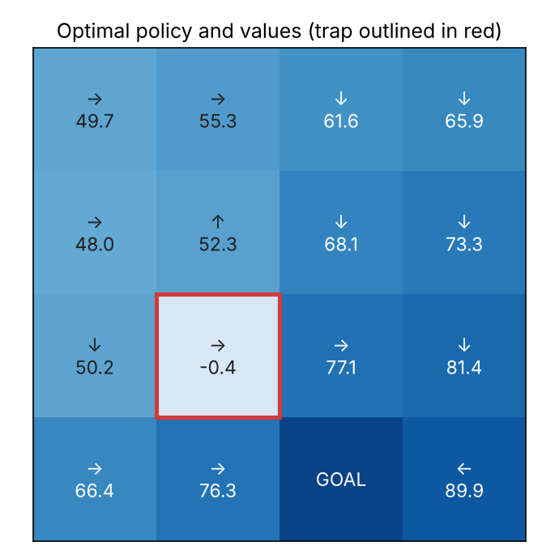
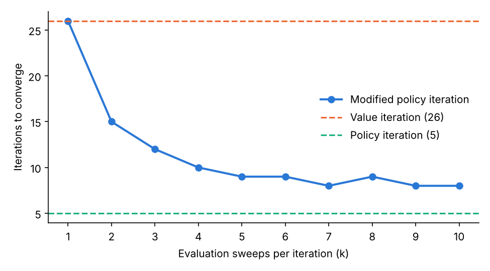
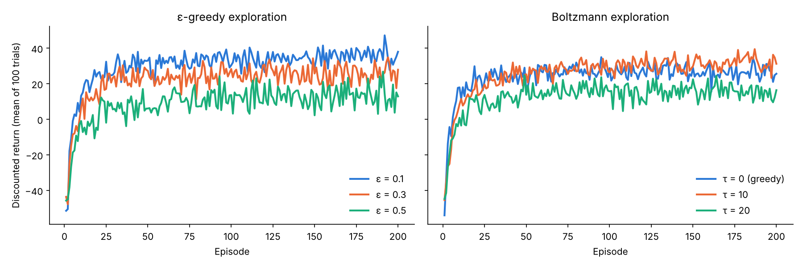
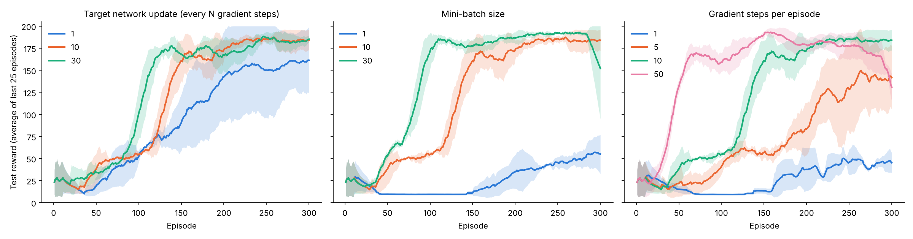
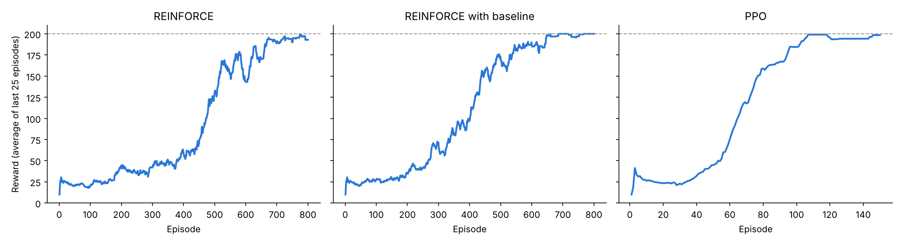

# Reinforcement Learning: From Planning to Deep RL

Four notebooks that build up reinforcement learning step by step: from solving a known MDP, to learning from experience in a table, to deep Q-networks, to policy-gradient methods. Each notebook runs a set of controlled experiments and explains the results.

| # | Notebook | Methods | Environment |
|---|---|---|---|
| 1 | [MDP planning](01_mdp_planning.ipynb) | Value iteration, policy iteration, modified policy iteration | 4×4 stochastic grid world |
| 2 | [Tabular Q-learning](02_q_learning.ipynb) | Q-learning with ε-greedy and Boltzmann exploration | Same grid world, unknown model |
| 3 | [Deep Q-Networks](03_dqn_cartpole.ipynb) | DQN with experience replay and a target network | CartPole |
| 4 | [Policy gradients](04_policy_gradients_cartpole.ipynb) | REINFORCE, REINFORCE with baseline, PPO | CartPole |

## Highlights

### 1. Planning in a known MDP
All three algorithms find the same optimal policy, which plays safe around the trap. Modified policy iteration interpolates between the other two: with 1 evaluation sweep it is value iteration (26 iterations), and with 5+ sweeps it needs 8–9 iterations, close to policy iteration (5), without solving a linear system.

<p align="center">
  
  
</p>

### 2. Tabular Q-learning
More exploration costs reward during training but learns a better policy. Boltzmann exploration (τ = 10) gets the best of both: more training reward than a greedy agent and 75% optimal actions after 2000 episodes, against 53% for greedy.



### 3. Deep Q-Networks
Ablations of three DQN design choices, each over 3 seeds. Updating the target network too often, mini-batches that are too small, or too few gradient steps per episode all slow or prevent learning. The notebook links the target network to value iteration.



### 4. Policy gradients
PPO solves CartPole in **106 episodes** against 674 for REINFORCE, and adding a value baseline makes REINFORCE stable (perfect test score).



## Repository structure

```
├── maze.py                              # MDP class (value/policy iteration) and the grid world
├── 01_mdp_planning.ipynb
├── 02_q_learning.ipynb
├── 03_dqn_cartpole.ipynb
├── 04_policy_gradients_cartpole.ipynb
├── figures/
└── requirements.txt
```

## How to run

```bash
python3 -m venv .venv
source .venv/bin/activate
pip install -r requirements.txt
```

Then run any notebook. All experiments are seeded and run on a CPU: notebooks 1, 2 and 4 take about a minute each, and notebook 3 about 5 minutes.

## Acknowledgements

Based on assignments from **CS 885 – Reinforcement Learning** at the University of Waterloo. The grid world, the "advertise or save" MDP and parts of the experiment design come from the course materials. The implementations and analysis are my own.

## Author

Giovanni (Jonathan) Zingaro · [GitHub](https://github.com/jonathanzingaro-jpg) · [LinkedIn](https://www.linkedin.com/in/jonathanzingaro/)
